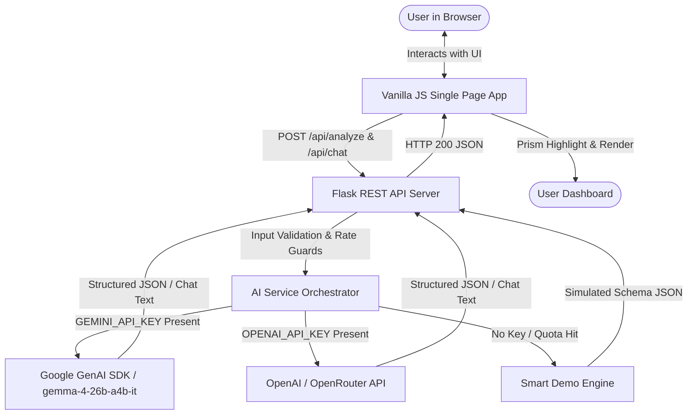

# CodeBuddy AI — Your Personal AI Coding Mentor

> An AI-powered coding companion specifically engineered for beginner programmers powered by **Google Gemma 4 (`gemma-4-26b-a4b-it`)** via the official **Google GenAI SDK (`google-genai`)**. Generate code from plain-English descriptions, understand logic step-by-step, uncover and fix sneaky bugs, receive clean idiomatic improvements, create thorough test cases, chat interactively with conversation history, and learn core CS concepts without gatekeeping.

---

## 🌟 Overview & Problem Statement

Beginner programmers often encounter cryptic compiler errors, off-by-one loops, and confusing syntax. Existing AI tools often dump raw solutions without explaining the underlying reasoning, creating passive dependency rather than genuine comprehension.

**CodeBuddy AI** bridges this gap by acting as an encouraging, patient senior teaching assistant. It explains the "why" behind the code, provides relatable real-world analogies, and highlights edge cases without ever exposing the user or server to arbitrary code execution risks.

---

## 🚀 Key Features

### 1. 💡 Code Generation (Gemma 4)
- Describe what you want to build in plain English.
- Gemma 4 writes clean, well-commented, beginner-friendly code with safe guard clauses.
- Itemizes the key concepts used and provides a runnable usage example.
- One-click **Insert in Editor** button to immediately run further inspections or tests.

### 2. 🔍 Explain My Code
- High-level summary of what the code achieves.
- Step-by-step logic walkthrough.
- Component breakdown table (variables, functions, loops, and their roles).
- Expected output (with honest disclaimers if input-dependent).
- Beginner concepts explained with memorable real-world analogies.

### 3. 🐛 Debug & Find Bugs
- Static inspection for syntax errors, logical bugs, and runtime hazards.
- Clear distinction between **Verified Errors** and **Suspected Issues**.
- Line-by-line context with before/after recommended fixes.
- Prevention tips to help beginners avoid similar mistakes in the future.

### 4. ✨ Optimize & Clean Code
- Refactors code for readability, performance, and idiomatic standards.
- Preserves original business logic and program intent.
- Itemized change log explaining the benefits of each modification.
- Dedicated **Copy Corrected Code** button for one-click workflow.

### 5. 🧪 Generate Test Cases
- Creates comprehensive test plans covering:
  - **Normal Cases** (Happy path valid inputs)
  - **Boundary Cases** (0, minimums, maximums, single items)
  - **Invalid / Edge Cases** (Negative inputs, empty collections, nulls)
- Explains why each test case matters in professional software engineering.

### 6. 🎓 Beginner Learning Mode
- Primary concept identification (e.g. Recursion, State Mutation, Pointers).
- Plain-English definitions without academic gatekeeping.
- **Jargon Buster** dictionary defining terms like *parameter*, *return value*, and *scope*.
- Isolated mini-example with syntax highlighting.
- Next topics to explore and a mini practice challenge.

### 7. 💬 Interactive Follow-Up Chat with History
- Ask questions about the current code snippet directly below the results.
- Gemma maintains multi-turn conversation context (e.g. *"Can you explain line 3 in simpler terms?"* or *"How do I handle negative numbers?"*).
- Reset chat button to start a fresh discussion at any time.

### 8. 🕒 Session History & State Persistence
- Automatically persists recent analyses in browser `localStorage`.
- Revisit and restore both code and analysis results with one click.
- Single-click "Clear History" button.
- Zero credentials or sensitive data stored client-side.

### 9. ⚡ Multi-Provider Architecture & Smart Demo Fallback
- **Google Gemma 4 (Primary):** Powered by the official Google GenAI Python SDK (`google-genai`).
- **OpenAI / OpenRouter (Secondary):** Automatic fallback when configured.
- **Smart Demo Mode:** Works immediately with realistic simulated responses across all 6 modes if no API key is set or if rate limits are reached.

---

## 🛠️ Technology Stack

| Layer | Technologies |
|---|---|
| **Frontend** | HTML5, Modern CSS3 (CSS Variables, Flexbox/Grid), Vanilla JavaScript (ES6+) |
| **Styling & Theme** | Developer Dark Navy theme, Electric Blue (`#3b82f6`), Violet (`#8b5cf6`), Cyan (`#06b6d4`), Glassmorphism |
| **Syntax Highlighting** | Prism.js (Tomorrow Night Theme) with line numbering |
| **Backend** | Python 3.11+, Flask 3.x REST API, Flask-CORS |
| **AI Integration** | Google GenAI SDK (`google-genai>=2.0.0`), Gemma 4 (`gemma-4-26b-a4b-it`) |
| **Secondary AI** | OpenAI Python SDK (`openai>=1.12.0`) / OpenRouter |
| **Configuration** | `python-dotenv` for backend environment variable isolation |
| **Automated Testing** | `pytest` testing suite (22 passing tests covering all modes & chat) |

---

## 🏛️ Architecture & Workflow



---

## 🔒 Security & Safety Guarantees

1. **Zero Server-Side Execution:** The application statically inspects code. It **never** uses `eval()`, `exec()`, or compiles arbitrary user code on the server.
2. **Untrusted Input Isolation:** System instructions explicitly command the AI model to treat code strictly as passive, untrusted input data to prevent prompt injection attacks.
3. **Protected Credentials:** `GEMINI_API_KEY` and other keys are kept strictly within the server `.env` file and are never sent to the browser or exposed in client responses.
4. **Input Size Limits:** Server limits payloads to 15,000 characters and enforces a 1MB Flask maximum content length.
5. **Quota & Rate-Limit Resilience:** The backend detects HTTP 429 quota errors and automatically falls back to Smart Demo Mode with an informative toast warning.

---

## 💻 Installation & Setup (Windows)

### Prerequisites
- Python 3.10+ (or Python 3.11+) installed on Windows.
- Git installed.

### Step 1: Navigate to the Repository
```powershell
cd "f:\CodeBuddy AI — Beginner Code Helper"
```

### Step 2: Set Up Virtual Environment & Dependencies
```powershell
# Using uv (recommended for ultra-fast setup):
uv pip install -r requirements.txt --python .venv\Scripts\python.exe

# Or using standard pip:
.\.venv\Scripts\Activate.ps1
python -m pip install -r requirements.txt
```

### Step 3: Configure Environment Variables
Copy `.env.example` to `.env`:
```powershell
copy .env.example .env
```

Open `.env` in your editor and add your Gemini API key:
```env
# Google Gemini & Gemma 4 API Key (Get free at https://aistudio.google.com/app/apikey)
GEMINI_API_KEY=your_gemini_api_key_here

# Gemma 4 Model ID
GEMMA_MODEL=gemma-4-26b-a4b-it

# Server Port
PORT=5000

# Environment
FLASK_ENV=development
```

*(Note: If you leave `GEMINI_API_KEY` empty, CodeBuddy AI runs in Smart Demo Mode automatically!)*

### Step 4: Run the Application
```powershell
# Option 1: Double-click or run run.bat
.\run.bat

# Option 2: Run directly with python
.\.venv\Scripts\python.exe app.py
```

Open your browser at:
👉 **[http://127.0.0.1:5000](http://127.0.0.1:5000)** (or `http://127.0.0.1:5001` / `http://127.0.0.1:5050`)

---

## 🧪 Testing & Quality Assurance

Run the automated test suite covering all 6 modes, all 5 languages, and follow-up chat with history:
```powershell
.\.venv\Scripts\python.exe -m pytest tests\test_app.py -v
```

**Test Results:**
```
tests/test_app.py::test_index_route PASSED                               [  4%]
tests/test_app.py::test_health_check_endpoint PASSED                     [  9%]
tests/test_app.py::test_samples_endpoint PASSED                          [ 13%]
tests/test_app.py::test_analyze_empty_payload PASSED                     [ 18%]
tests/test_app.py::test_analyze_empty_code PASSED                        [ 22%]
tests/test_app.py::test_analyze_unsupported_language PASSED              [ 27%]
tests/test_app.py::test_analyze_unsupported_mode PASSED                  [ 31%]
tests/test_app.py::test_analyze_oversized_code PASSED                    [ 36%]
tests/test_app.py::test_analyze_non_json_request PASSED                  [ 40%]
tests/test_app.py::test_analyze_all_modes[explain] PASSED                [ 45%]
tests/test_app.py::test_analyze_all_modes[bugs] PASSED                   [ 50%]
tests/test_app.py::test_analyze_all_modes[improve] PASSED                [ 54%]
tests/test_app.py::test_analyze_all_modes[generate] PASSED               [ 59%]
tests/test_app.py::test_analyze_all_modes[tests] PASSED                  [ 63%]
tests/test_app.py::test_analyze_all_modes[learn] PASSED                  [ 68%]
tests/test_app.py::test_analyze_all_languages[python] PASSED             [ 72%]
tests/test_app.py::test_analyze_all_languages[javascript] PASSED         [ 77%]
tests/test_app.py::test_analyze_all_languages[java] PASSED               [ 81%]
tests/test_app.py::test_analyze_all_languages[c] PASSED                  [ 86%]
tests/test_app.py::test_analyze_all_languages[cpp] PASSED                [ 90%]
tests/test_app.py::test_chat_followup_success PASSED                     [ 95%]
tests/test_app.py::test_chat_followup_empty_message PASSED               [100%]
============================= 22 passed in 17.89s =============================
```

---

## 📄 License & Attribution

Distributed under the MIT License. Built with Google Gemma 4 and Google GenAI SDK for hackathons, beginner developers, and computer science education.
